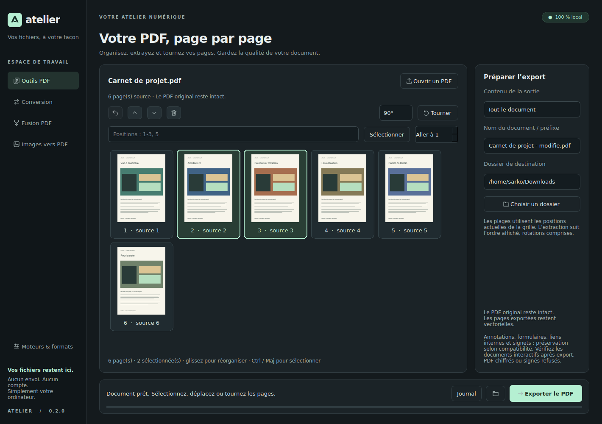
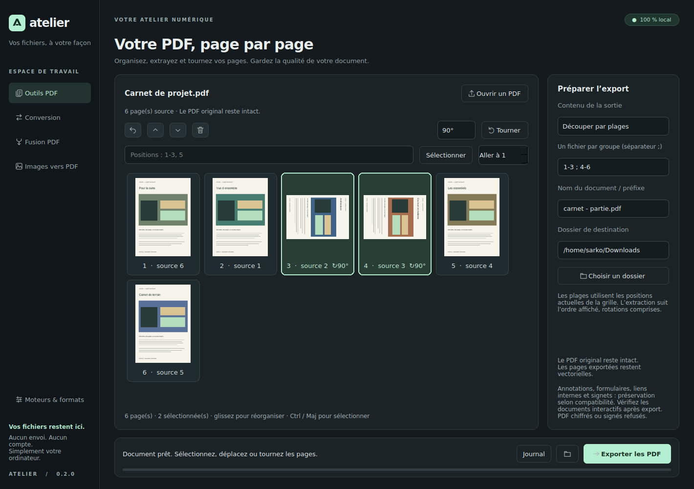

# Atelier

Une application de bureau personnelle pour **convertir des images et manipuler des PDF sur Linux**.
Interface en français, thème sombre, aucun serveur, aucun compte, aucun envoi de fichiers.

## Lancer pendant le développement

Le projet utilise Python 3.11 minimum et un environnement `.venv` local. La version vérifiée
dans cet environnement utilise Python 3.12 sur Linux x86_64.

```bash
./scripts/setup.sh   # première préparation ; télécharge uniquement des paquets Python dans .venv
./scripts/dev.sh
```

Si `.venv` a déjà été préparé, `./scripts/dev.sh` suffit. Le lanceur fonctionne aussi depuis
un autre dossier et accepte des chemins d’images en arguments.

Dans VS Code, sélectionner l’interpréteur `.venv/bin/python`, puis la configuration **Atelier**
avec F5 (extensions Python et Python Debugger de VS Code nécessaires). Aucun paquet système
n’est installé par les scripts. Si `python3 -m venv` est indisponible sur une autre machine,
le script s’arrête : installer le composant venv de la distribution reste une décision manuelle.

Le lancement retire, pour le processus Atelier seulement, les chemins de schémas GTK privés
hérités de VS Code Snap. Ce contournement a été nécessaire sur la machine de développement.
Les paramètres du système, de VS Code et du shell ne sont pas modifiés.

## Ce qui fonctionne

- Import multiple par dialogue ou glisser-déposer ; doublons évités.
- Conversion par lots vers PNG, JPEG, WebP, TIFF ou BMP selon les encodeurs disponibles.
- Réglage JPEG/WebP avec perte ; WebP sans perte proposé par défaut.
- Copie binaire des formats identiques par défaut, lorsque métadonnées et orientation le permettent.
  Décocher cette option pour appliquer de nouveaux réglages d’encodage au même format.
- Fusion de PDF, réorganisation des fichiers par glissement ou boutons haut/bas.
- Images fixes assemblées dans un PDF, une image par page.
- **Outils PDF** : miniatures, sélection multiple, déplacement des pages par glisser-déposer,
  extraction, retrait, rotations 90°/180°/270° et découpage par groupes ou une page par fichier.
- Annulation des 20 dernières modifications du plan de pages avec Ctrl+Z.
- Choix de la destination, progression, annulation, journal de session et erreurs par fichier.
- Ouverture du dossier de sortie ; double-clic sur un élément terminé pour ouvrir le résultat.
- Traitements dans un processus séparé, interface réactive et nettoyage des temporaires.
- Aucun écrasement : un nom existant devient `image (1).png`, puis `image (2).png`, etc.

Pour commencer : choisir un espace à gauche, ajouter les fichiers, ajuster les réglages,
choisir un dossier et lancer le traitement. **Ctrl+O** ajoute des fichiers ; **Suppr** retire
la sélection de la liste. Les originaux ne sont jamais supprimés par l’application.

## Manipuler un PDF

Ouvrir **Outils PDF**, puis choisir ou déposer **un seul document**. Les miniatures sont
générées à la demande ; les pages conservent leur numéro **source** et affichent leur **position
actuelle** dans le futur document. Ctrl+clic et Maj+clic permettent la sélection multiple ;
Ctrl+A sélectionne tout lorsque la grille a le focus.

- Glisser une sélection avant/après une page pour la déplacer. Les boutons haut/bas et
  **Alt+Haut / Alt+Bas** avancent ou reculent la sélection dans l’ordre de sortie.
- Choisir 90°, 180° ou 270°, puis **Tourner** ; **Ctrl+R** applique l’angle courant.
- **Suppr** ou la corbeille retire la sélection du futur export. **Ctrl+Z** restaure la dernière
  modification. Ces raccourcis de modification s’appliquent quand la grille a le focus.
- Le champ **Positions** accepte `1-3, 5` pour sélectionner des positions dans l’ordre courant,
  après les déplacements/retraits. Ce ne sont pas les anciens numéros source.
- **Tout le document** exporte l’ordre affiché ; **La sélection** extrait les pages sélectionnées
  dans cet ordre, avec leurs rotations.
- **Découper par plages** accepte `1-3 ; 4-6 ; 7, 9` : chaque groupe séparé par `;` crée un PDF.
  Les positions d’un même groupe suivent l’ordre saisi ; les groupes peuvent se chevaucher.
- **Une page par fichier** produit un PDF pour chaque page restante. Les sorties multiples
  sont nommées `nom - 001.pdf`, `nom - 002.pdf`, etc. Les collisions reçoivent un suffixe.

La grille vide ne peut pas être exportée. Les plages inversées, répétées dans un groupe ou hors
limites sont refusées. Les modifications sont conservées pendant la navigation entre espaces,
mais restent en mémoire : ouvrir un autre PDF ou quitter l’application abandonne ce plan.

Lancement direct : `./scripts/dev.sh --pdf /chemin/document.pdf`. Un PDF donné seul en argument
ouvre aussi les outils PDF ; plusieurs PDF ouvrent l’espace de fusion.





## Formats et qualité

La [matrice détaillée](docs/FORMATS.md) distingue les formats, modes couleur et limites réelles.
La fenêtre **Moteurs & formats** indique les capacités de l’installation courante.

JPEG et WebP avec perte sont annoncés comme destructifs, même à qualité 100. Un PNG issu
d’un JPEG ne récupère pas les détails déjà perdus. La transparence est composée sur fond blanc
pour JPEG/BMP. Les images animées ou multipages sont refusées pour éviter de perdre des images.
Les modes couleur non gérés, dont CMYK, sont refusés plutôt que convertis implicitement.

EXIF, ICC, DPI et textes PNG sont conservés lorsque le format et le mode le permettent ;
ce n’est pas une garantie de conservation de toutes les métadonnées. Les données GPS peuvent
être présentes dans EXIF. L’option de suppression des métadonnées est disponible pour les images.
Une fusion PDF crée un nouveau document et ne conserve pas une signature numérique : les
documents chiffrés ou contenant un champ de signature sont refusés dans cette version.

Les outils PDF copient les pages sans rasterisation et conservent les métadonnées Info et XMP
lisibles. Les signets, liens et formulaires compatibles sont importés par pypdf, sans garantie
exhaustive pour les documents interactifs, le balisage d’accessibilité ou PDF/A. Les champs de
formulaire peuvent manquer dans les miniatures : l’aperçu reste indicatif. Voir les limites
détaillées dans [la matrice PDF](docs/FORMATS.md).

## Vérifier

```bash
PYTHONPATH=src QT_QPA_PLATFORM=offscreen .venv/bin/python -m pytest -q
.venv/bin/ruff check src tests scripts
.venv/bin/ruff format --check src tests scripts
.venv/bin/mypy
QT_QPA_PLATFORM=offscreen ./scripts/dev.sh --smoke-test
```

Les tests créent de vrais fichiers image/PDF, relisent les sorties et couvrent les pixels,
la profondeur 16 bits, la transparence, les métadonnées, le texte et l’ordre des pages,
l’absence d’écrasement, les erreurs et l’annulation du processus depuis Qt.

Pour vérifier le démarrage graphique dans votre session : `./scripts/dev.sh --smoke-test`.
L’option `--screenshot /tmp/atelier.png` enregistre une capture de la fenêtre après son affichage.
Le rapport d’exécution se trouve dans [docs/VALIDATION.md](docs/VALIDATION.md).

## Version Linux installable

```bash
.venv/bin/python scripts/build_linux.py
```

Cette commande construit le wheel et une archive dans `dist/`, avec toutes les wheels Python
nécessaires à l’exécution. Le téléchargement est nécessaire pendant la préparation de l’archive.
Elle n’installe rien dans les répertoires du système.
Pour reconstruire sans réseau, ajouter `--wheelhouse /chemin/vers/wheelhouse` en pointant
vers le dossier de wheels d’une archive précédente.

Extraire l’archive, puis depuis le dossier extrait :

```bash
python3 scripts/install_linux.py
```

L’installation est **hors ligne et sans sudo**, dans `~/.local/share/atelier`, avec un lanceur
`~/.local/bin/atelier` et une entrée de menu dans `~/.local/share/applications`. Elle refuse
d’écraser une installation ou un lanceur existant. `atelier` fonctionne si `~/.local/bin`
figure dans votre PATH ; l’entrée du menu utilise un chemin absolu.

Ce paquet inclut les bibliothèques Python/Qt mais **pas l’interpréteur Python ni toutes les
bibliothèques de la distribution**. Il cible l’architecture et la version mineure Python de
la construction ; l’installateur les vérifie. Un bureau Wayland ou X11 et les bibliothèques
Linux requises par Qt doivent déjà être présents. Le paquet testé est destiné à Linux x86_64,
Python 3.12, glibc récente (les wheels Qt utilisées exigent glibc ≥ 2.34).

Des chemins alternatifs permettent de tester sans toucher au compte utilisateur :

```bash
python3 scripts/install_linux.py --prefix /tmp/atelier-install/app \
  --bin-dir /tmp/atelier-install/bin --desktop-dir /tmp/atelier-install/menu
```

Pour désinstaller l’installation par défaut, retirer uniquement le dossier
`~/.local/share/atelier`, le lanceur `~/.local/bin/atelier` et l’entrée
`~/.local/share/applications/fr.atelierlocal.Atelier.desktop`. Les conversions ne sont pas
stockées dans ces chemins. Les préférences Qt sont dans
`~/.config/AtelierLocal/Atelier.conf` (ou le dossier indiqué par XDG_CONFIG_HOME).

## Architecture et suite

Voir [les décisions d’architecture](docs/ARCHITECTURE.md), [les dépendances et licences](docs/DEPENDENCIES.md)
et [la feuille de route](docs/ROADMAP.md).

Cette version ne propose pas encore les conversions bureautiques, audio/vidéo, SVG, AVIF, OCR,
ni la reprise d’une file ou d’un plan PDF après redémarrage. LibreOffice et FFmpeg ne sont
jamais installés ni lancés par cette version.

Les traitements sont locaux, mais le processus de conversion **n’est pas un bac à sable de
sécurité**. Les protections de décodage restent actives. Ne pas considérer l’application comme
un outil d’assainissement de documents hostiles. Il n’y a pas de quota artificiel de fichiers ;
la mémoire, l’espace disque et les limites de sécurité des moteurs restent applicables.
